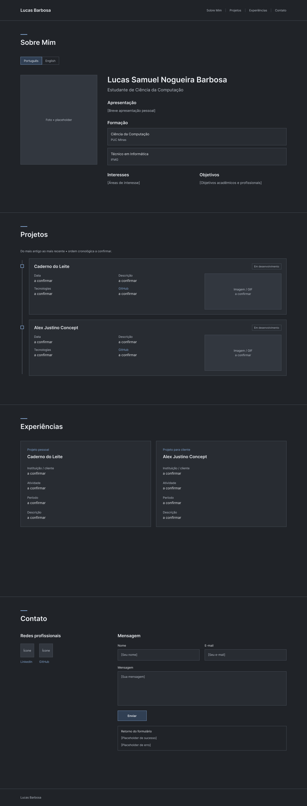
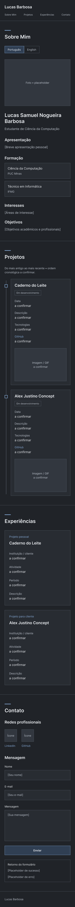

# Portfólio — Lucas Barbosa

## Sobre o Projeto

Portfólio pessoal desenvolvido para a disciplina de Desenvolvimento de Interfaces Web da PUC Minas, ministrada pelo professor João Paulo Aramuni. Apresenta formação, interesses, projetos, experiências de desenvolvimento e canais de contato.

## Status do Projeto

Versão com funcionalidades locais implementadas. A entrega final ainda depende de configurar e testar o envio real de e-mail, completar os dados e mídias dos projetos e publicar o site. Nenhum envio ou deploy é apresentado como concluído antes da verificação.

## Links Úteis

- [Repositório](https://github.com/Lucas-tech255/portfolio)
- [LinkedIn](https://www.linkedin.com/in/lucasnogueirabarbosa)
- Site publicado: pendente de ativação do GitHub Pages.

## Funcionalidades Principais

- Página única com navegação pelas quatro seções.
- Apresentação em português e inglês, com preferência salva no navegador.
- Timeline gerada por JavaScript, ordenada do mais antigo ao mais recente conforme ordem confirmada pelo autor.
- Filtros de projetos pessoais e para cliente.
- Experiências organizadas em blocos responsivos.
- Links com ícones SVG para GitHub e LinkedIn.
- Formulário com campos obrigatórios, validação de formato, limite de tamanho e estados de envio, sucesso e erro.
- Integração de envio preparada para a API REST do EmailJS, dependendo da configuração.
- Navegação por teclado, link para pular ao conteúdo e retorno do formulário anunciado a tecnologias assistivas.

## Tecnologias Utilizadas

| Tecnologia | Uso |
| --- | --- |
| HTML5 | Estrutura semântica e formulário |
| CSS3 | Tema escuro, timeline e ajustes responsivos |
| JavaScript | Idiomas, renderização, filtros e formulário |
| Bootstrap 5.3.8 | Grid, espaçamentos e componentes, via CDN |
| EmailJS REST API | Serviço externo para envio, ainda não configurado |
| Git e GitHub | Versionamento |
| Figma | Wireframes |
| GitHub Pages | Hospedagem prevista, ainda não ativada |

### Dependências

A única biblioteca visual é Bootstrap 5.3.8, carregada pela CDN no HTML. Não há npm, compilação, banco de dados ou servidor próprio. Os ícones são SVG incorporados. A integração EmailJS utiliza `fetch`, sem SDK.

## Arquitetura

O navegador carrega HTML, CSS e os três scripts locais. `projetos.js` contém os dados; `script.js` monta os elementos da timeline, troca os textos da apresentação e trata o envio. O formulário envia uma requisição HTTPS para o serviço EmailJS, responsável por enviar o e-mail pelo serviço conectado pelo autor. O destinatário é definido no template do EmailJS, sem expor um endereço pessoal na interface.

Esta implementação usa uma integração externa, sem backend próprio. O site não é anunciado como aplicação Spring Boot.

## Estrutura de Pastas

| Caminho | Finalidade |
| --- | --- |
| index.html | Conteúdo, navegação, seletor e formulário |
| style.css | Estilos personalizados |
| script.js | Funcionalidades interativas |
| projetos.js | Dados dos projetos |
| config.js | Identificadores públicos do EmailJS |
| docs/wireframes/desktop.png | Protótipo desktop |
| docs/wireframes/mobile.png | Protótipo celular |
| docs/EXPLICACAO.md | Explicação do código e roteiro de apresentação |
| docs/CONFIGURACAO.md | Configuração, publicação e pendências |
| assets/projetos/ | Local reservado para imagens reais |
| README.md | Documentação |

## Instalação e Execução

### Pré-requisitos

Navegador atualizado, Git para clonar, internet para carregar Bootstrap e enviar mensagens. Python 3 é uma opção para iniciar servidor local.

```bash
git clone https://github.com/Lucas-tech255/portfolio.git
cd portfolio
python3 -m http.server 8000
```

Abra `http://localhost:8000`. Interrompa com Ctrl+C. Sem Python, use Live Server do VS Code. O HTML pode ser aberto diretamente para visualizar o layout, mas prefira um servidor para testar o envio HTTP e as políticas de origem do EmailJS.

### Configuração do formulário

Siga [as instruções](docs/CONFIGURACAO.md). Preencha `publicKey`, `serviceId` e `templateId` em `config.js`. O template deve usar `from_name`, `reply_to` e `message` e ter destinatário fixo configurado na conta. Somente a chave pública deve ficar no frontend.

Sem configuração, o formulário informa a pendência e não simula um envio bem-sucedido.

## Deploy

Publicação preparada para GitHub Pages. No repositório, escolha Settings → Pages → Deploy from a branch → main → /(root) → Save. Após ativação, a URL esperada é `https://lucas-tech255.github.io/portfolio/`; isso não confirma que já esteja online. Teste a URL e atualize esta seção com o link efetivamente publicado.

## Demonstração — Wireframes

Wireframes de média fidelidade criados no Figma. O layout implementado usa a foto à direita e coloca Alex antes do Caderno do Leite, conforme decisões posteriores do autor.

### Desktop



### Celular



## Verificações

Verificações locais: sintaxe JavaScript, IDs e âncoras, associação entre rótulos e campos e existência dos arquivos referenciados. Testes com DOM/API simulados verificaram troca de idiomas, ordem e filtro dos projetos, bloqueio de configuração ausente, validação de texto, payload e retornos de sucesso/erro. Esses testes não comprovam recebimento real de e-mail nem substituem revisão visual no navegador.

Ainda necessário: conferir desktop e celular no navegador, testar recebimento de mensagem real após configuração e confirmar URL pública. O layout original já havia sido testado pelo autor; esta versão modificada ainda precisa dessa revisão visual.

## Pendências de Conteúdo

- Confirmar datas de início e períodos das experiências.
- Preencher tecnologias e repositórios dos dois projetos em `projetos.js`.
- Adicionar imagens/GIFs reais em `assets/projetos/` e preencher o caminho de cada imagem.
- Substituir o espaço reservado da foto por imagem pessoal, se desejado.
- Configurar EmailJS e comprovar recebimento.
- Publicar e verificar o link.

## Documentações Utilizadas

- [Bootstrap](https://getbootstrap.com/docs/5.3/)
- [EmailJS — envio pela API REST](https://www.emailjs.com/docs/rest-api/send/)
- [GitHub Pages](https://docs.github.com/en/pages)
- [Template de README do professor](https://github.com/joaopauloaramuni/desenvolvimento-de-interfaces-web/blob/main/TEMPLATES/template_README.md)

## Autor

Lucas Samuel Nogueira Barbosa — [GitHub](https://github.com/Lucas-tech255) · [LinkedIn](https://www.linkedin.com/in/lucasnogueirabarbosa)

## Agradecimentos

Professor João Paulo Aramuni pelas orientações do laboratório. Desenvolvimento iniciado pelo autor e complementado com auxílio de IA; a explicação das alterações está em `docs/EXPLICACAO.md`.
